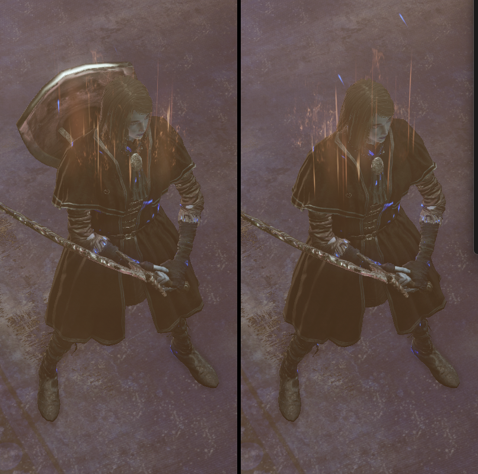

# HideSheathedLeft

A Dark Souls III (PC, 1.15.0) mod that **hides the model of the item in your left
hand while that item is sheathed** — instead of showing it hanging on your
character's back — plus a **generic DLL mod loader shell** that lets several
mods share the `xinput1_3.dll` import slot without fighting over the file name.

**[Download the latest release](https://github.com/xiangchi7/HideSheathedLeft-for-DS3/releases/latest)**
— the zip contains both DLLs plus the configuration file.

No code is patched and no engine function is hooked: the mod only rewrites a few
dummy-poly fields of the `WepAbsorpPosParam` parameter table, so there is
nothing for the game's anti-tamper layer to trip over.



*Left: vanilla — the left-hand shield is attached to the character's back.
Right: with the mod — the sheathed left-hand item is not rendered at all.*

---

## What it does

The character is the player's, and the hidden item is whatever occupies the
**left hand** — weapons, shields, catalysts, staves, bows, anything equipable in
a hand slot.

| Situation | Vanilla | With this mod |
|---|---|---|
| Right-hand weapon **two-handed**, left hand holds a shield / staff / talisman / bow / second weapon | left item hangs on the back | **not rendered at all** |
| Two-handing released | — | left item **reappears in the hand immediately** |
| Right hand holds a **paired weapon one-handed** (Sellsword Twinblades, Gotthard Twinswords, …) | the spare blade hangs on the body | **not rendered at all** |
| **Two-handing a paired weapon** | the previously held left item hangs on the back | **not rendered at all** |
| Left-hand item actually in use (blocking, left-hand attacks, casting) | in hand | unaffected |
| Right-hand item itself | — | unaffected |

Judgement is delegated entirely to the game: the item is hidden exactly while
the engine uses the "left hand sheathed" attachment, so drawing it again
restores it instantly with no extra state machine.

## Requirements

* Dark Souls III, Steam, **App version 1.15.0** (64-bit).
* No mod loader, injector or ASI loader is required — the mod loads itself.
* Dark Souls III has no Easy Anti-Cheat. Playing online with modified params is
  nevertheless done at your own risk (Bandai Namco runs server-side save
  checks); **offline use is recommended**.

## Installation

1. **Close the game.**
2. Copy these three files into the game folder
   (`…\steamapps\common\DARK SOULS III\Game\`):

   | File | Purpose |
   |---|---|
   | `dist/xinput1_3.dll` | loader shell; the game imports this DLL by name, so this is how everything gets in |
   | `dist/HideSheathedLeft.dll` | the mod itself |
   | `HideSheathedLeft.ini` | configuration (optional but recommended) |

3. If the game folder already contains an `xinput1_3.dll` (another mod that
   squats the same slot), **rename it first** — see
   [Using it as a mod loader shell](#using-it-as-a-mod-loader-shell).

On the next launch the game folder will contain two log files:

`xinput1_3_proxy.log`
```
--- mod loader shell attached (pid 6304) ---
core HideSheathedLeft.dll -- loaded (handle=0x...)
extra mods: 1 entry
  dkp_loader.dll -- loaded (handle=0x...)
```

`HideSheathedLeft.log`
```
--- HideSheathedLeft loaded (pid 6304) ---
param tables located: 4
```

`param tables located: 4` means the parameter table was found and rewritten.
(Any non-zero number is fine; 1.15.0 keeps four in-memory copies and all of them
are written.)

## Configuration

`HideSheathedLeft.ini`, next to the DLLs. **It is re-read every few seconds —
edit, save, and the change takes effect while the game is running.** No restart.

```ini
[general]
HideLeftHang=1        ; core effect: hide the sheathed left-hand item. 0 = off
HidePairedOffhand=1   ; hide the spare models of a one-handed paired weapon. 0 = off
IntervalSeconds=4     ; how often the config is re-read / the patch re-applied
Log=1                 ; write HideSheathedLeft.log

[loader]
LoadCore=1            ; 1 = also load this mod's core; 0 = loader shell only
ExtraMods=dkp_loader.dll
ExtraModsDelayMs=0    ; 0 = load immediately (earliest); >0 = delay N ms, background thread
```

Setting both `HideLeftHang=0` and `HidePairedOffhand=0` restores vanilla
behaviour live (the mod snapshots the original values and puts them back).

## Using it as a mod loader shell

The game imports `XINPUT1_3.dll` by ordinal, and Windows resolves an imported
DLL **from the application directory first**. That makes `xinput1_3.dll` the
earliest automatic entry point into the process — but only one file can have
that name, so two mods that both want the slot cannot coexist as files.

The `xinput1_3.dll` shipped here is therefore a **shell**, not a squatter:

1. it mirrors the **complete export table** of the real system DLL (ordinals
   1–8, same names) and forwards every call to
   `%SystemRoot%\System32\xinput1_3.dll`, loaded by absolute path so it can
   never recurse into itself. Gamepad, rumble, Steam overlay and any module
   importing XInput by name or ordinal keep working;
2. it loads `HideSheathedLeft.dll` (`LoadCore=1`);
3. it loads **any number of other mod DLLs** listed in `ExtraMods`.

Because step 1–3 happen while the game's imports are being resolved, other mods
are loaded **earlier than any injector or launcher script could** — which is
exactly what mods that patch or redirect something during start-up need.

To add a mod:

```powershell
# 1. drop its DLL into the game folder under any name that is not
#    xinput1_3.dll / dinput8.dll / D3DCompiler_43.dll (those are other slots)
Copy-Item .\SomeMod.dll '…\DARK SOULS III\Game\' -Force
```
```ini
; 2. list it (comma or semicolon separated)
[loader]
ExtraMods=dkp_loader.dll, SomeMod.dll
```
3. Launch and check `xinput1_3_proxy.log` — each entry is logged as
   `loaded` or `FAILED`.

Notes:

* **A mod that documents itself as a proxy** ("rename this DLL to
  `xinput1_3.dll` and drop it in the game folder") only wanted the slot as a way
  in. Rename it to anything else, list it in `ExtraMods`, and this shell takes
  over the forwarding duty for it.
* **A mod that ships its own launcher/injector** (Mod Engine and friends) does
  not conflict — it uses its own route. Just do not let it also replace
  `xinput1_3.dll`.
* **A mod that wants a different slot** (`dinput8.dll`, `D3DCompiler_43.dll`,
  …) is independent of this shell; it lives under its own file name.
* **Asset/param mods** (files dropped into `menu/`, `parts/`, `param/`, …) need
  no loader at all and are unaffected.
* If a mod fails to load or misbehaves, it probably needs the game further
  along: set `ExtraModsDelayMs=3000` so it is loaded from a background thread
  after the game has initialised.

## Uninstall

Delete `xinput1_3.dll`, `HideSheathedLeft.dll`, `HideSheathedLeft.ini`,
`HideSheathedLeft.log` and `xinput1_3_proxy.log` from the game folder, and
restore any file you renamed. Nothing else is touched — the mod never writes to
game files, saves or the registry.

## How it works

Short version: `WepAbsorpPosParam` (`WEP_ABSORP_POS_PARAM_ST`) stores, per weapon
and per model 0–3, the **dummy poly** each model is attached to in each stance.
The engine picks the cluster from the weapon style alone:

| Weapon style | left slot uses | right slot uses |
|---|---|---|
| one-handed | `Left` | `Right` |
| two-handing the **right** weapon | **`LeftHang`** | `RightBoth` |
| two-handing the left weapon | `LeftBoth` | `RightHang` |

and if the selected dummy poly id is invalid, the engine scales the model to
zero and skips drawing it. So writing `-1` into the four `leftHang_*` fields
(row offsets `0x0A/0x14/0x1E/0x28`) makes "left hand sheathed" render as
nothing, while every other stance is untouched. Paired-weapon spare models are
`right_1..3` (`0x0E/0x18/0x22`).

The fields that *look* like the answer but are not, the exact runtime layout of
the parameter table, how it is located without any version-specific offsets, and
the measurements behind all of the above are documented in
**[docs/MECHANISM.md](docs/MECHANISM.md)**.

## Known limitations

* **The parameter table is shared by every character.** Hiding a sheathed
  left-hand item is therefore not, strictly speaking, player-only: an NPC that
  enters the "two-handing the right weapon with something in the left hand"
  state would also lose that model. In practice DS3 enemies hold their weapons
  continuously and almost never enter that state, but it is a real difference
  from the ideal. Making it strictly player-only requires either hooking the
  engine function that resolves the attachment (detectable from inside the
  process with a `PAGE_GUARD` trap + vectored exception handler) or editing the
  player-only animation set (`c0000`) to carry TAE event 710
  `HideEquippedWeapon`. Both are tracked as future work; see
  [docs/MECHANISM.md](docs/MECHANISM.md#8-making-it-strictly-player-only).
* `right_1..3` is rewritten for **all** weapons. For the overwhelming majority
  of weapons models 1–3 do not exist, so this is a no-op; for paired weapons it
  is the intended effect. If some special weapon ever looks wrong, set
  `HidePairedOffhand=0` to isolate it.
* Verified on 1.15.0 only. The table is located by scanning for its name, not by
  version-specific offsets, so other versions will likely work, but they have
  not been tested.

## Building

Requires the MSVC x64 build tools (Visual Studio 2022/2026 Build Tools are
enough) — no third-party dependencies.

```powershell
pwsh -ExecutionPolicy Bypass -File build.ps1                  # -> dist\
pwsh -ExecutionPolicy Bypass -File build.ps1 -Install         # + copy into the game
```

`-Install` also renames a pre-existing `xinput1_3.dll` to
`xinput1_3.dll.dkp-off` so nothing is lost.

## Troubleshooting

| Symptom | Cause / fix |
|---|---|
| The game crashes on start-up | `xinput1_3.dll` in the game folder is a different, incompatible mod (some proxy DLLs trip the game's anti-tamper). Delete or rename it — this shell replaces it. |
| The game runs but nothing happens | Check `HideSheathedLeft.log`. If it is missing, the shell did not run (is the file really named `xinput1_3.dll`?). If it says `param tables located: 0`, the parameter table was not found. |
| One specific weapon looks wrong | Set `HidePairedOffhand=0`; if the problem is gone it is the paired-weapon path. |
| Want to be sure the loader is not involved | Set `[loader] LoadCore=0` — the shell then loads nothing of its own. |
| Longer loading screens | The first parameter-table scan reads a few GB of process memory (once, at start-up, on a background thread). It does not affect in-game frame rate. |

## Repository layout

```
.github/ISSUE_TEMPLATE/      bug report template (asks for the two log files)
src/HideSheathedLeft.cpp     the mod: locate the param table, rewrite the attach fields
src/xinput1_3_proxy.cpp      the loader shell: XInput forwarding + ExtraMods loading
src/xinput1_3_proxy.def      export table (ordinal/name pairs of the real xinput1_3.dll)
HideSheathedLeft.ini         configuration
build.ps1                    MSVC build script
dist/                        build output (the two DLLs to install)
docs/MECHANISM.md            reverse-engineering notes and measurements
docs/evidence-*.png          before/after evidence
tools/                       reverse-engineering and verification helpers used to
                             find and prove the mechanism (not needed to run the mod)
CHANGELOG.md                 release history
```

The `tools/` scripts are Python 3 (standard library only) and were used to read
and patch the live parameter table, capture and diff screenshots, and inspect the
parameter-table owners. They are kept because they document how the mechanism was
established and are useful for further work.

## Credits and references

* [sovietspaceship/DSAnimStudio](https://github.com/sovietspaceship/DSAnimStudio)
  — its reimplementation of the engine's character assembler
  (`NewChrAsm`, `NewEquipSlot_Weapon`, `ParamData.WepAbsorpPosParam`) is what
  identifies the `LeftHang`/`RightHang` clusters and the
  "invalid dummy poly ⇒ scale 0, not drawn" rule, and it provides the
  `WEP_INVISIBLE_TYPE` / `WEP_DISP_POS_TYPE` / `WEP_HANG_POS_TYPE` enum values.
* [vswarte/fromsoftware-rs](https://github.com/vswarte/fromsoftware-rs) — DS3
  parameter-table and `SoloParamRepository` layout used by the tooling.
* [The Grand Archives DS3 cheat table](https://github.com/The-Grand-Archives/Dark-Souls-III-CT-TGA)
  and the community's trick-weapon material on the
  [Souls Modding wiki](https://soulsmodding.wikidot.com/tutorial:how-to-create-a-trick-weapon),
  which document the "point the absorption dummy poly somewhere harmless so the
  model disappears" technique.
* [igromanru's DS3 cheat engine guide](https://github.com/igromanru/Dark-Souls-III-Cheat-Engine-Guide)
  — background on DS3's protection and save-check situation.

No game assets, data files or copyrighted material are included in this
repository; the mod only writes to process memory at runtime.

## License

MIT — see [LICENSE](LICENSE).
